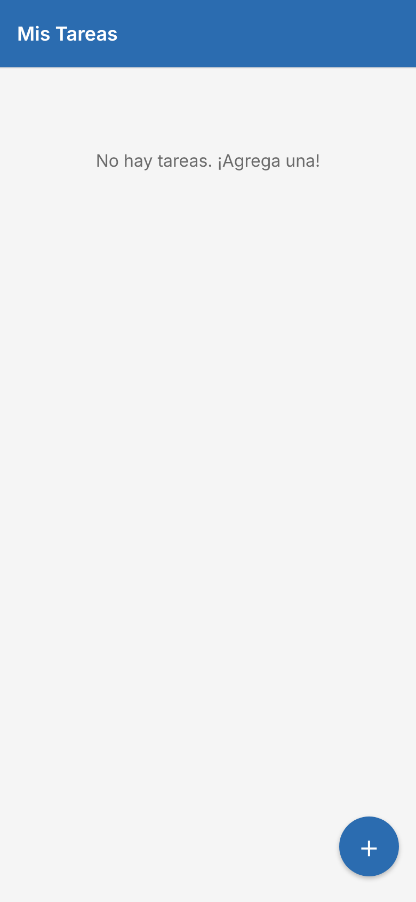
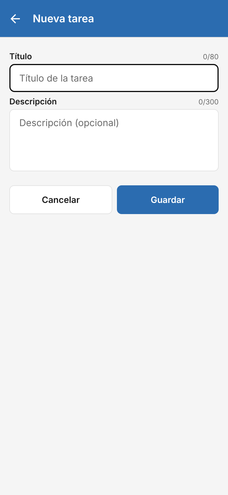
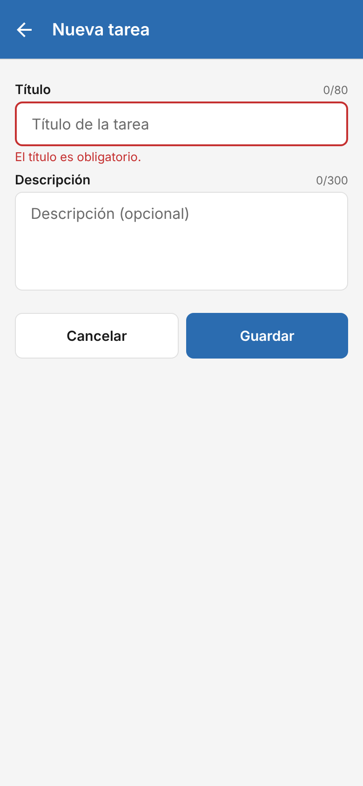
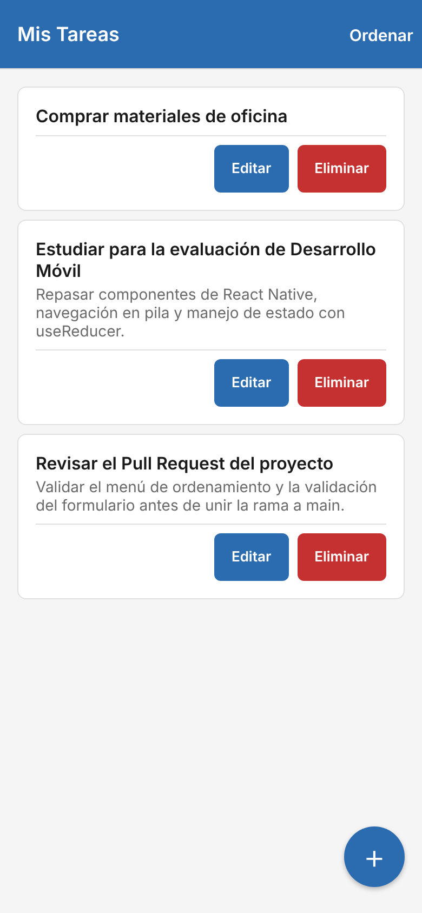
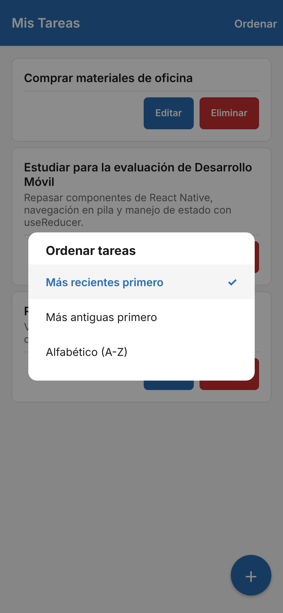
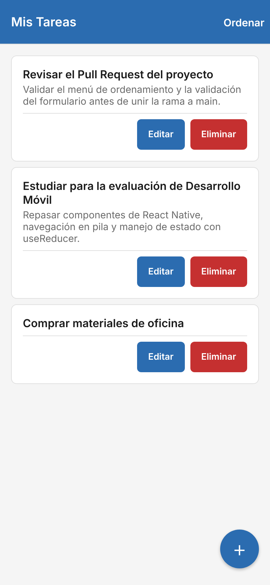
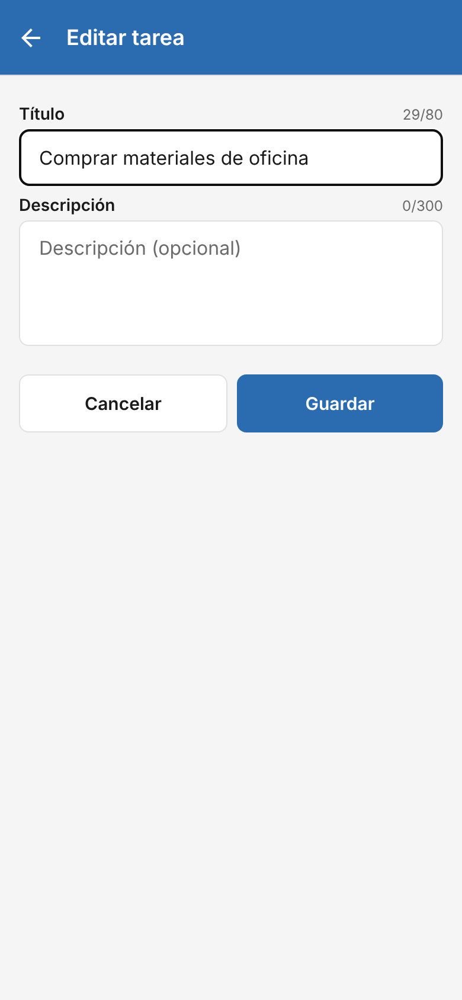
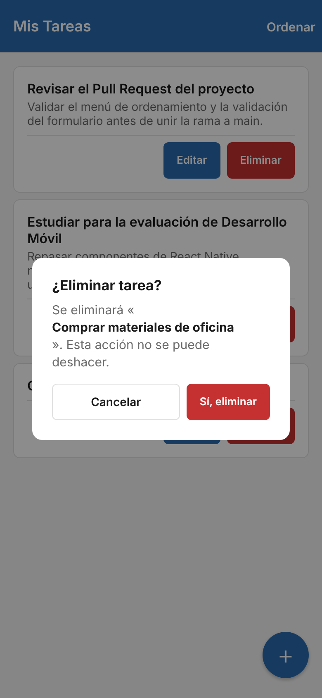

# To-Do List — EVU1 Desarrollo de Aplicaciones Móviles

Aplicación móvil de lista de tareas desarrollada con **React Native + Expo** y **TypeScript**. Permite agregar, editar y eliminar tareas con título y descripción.

**Integrantes:** Camilo Meriño · Cristóbal Bustos

## ¿Por qué React Native + Expo?

Aunque la pauta original de la evaluación proponía Ionic como referencia, el profesor permitió elegir libremente el stack tecnológico del proyecto. Elegimos React Native con Expo principalmente porque el equipo ya tenía experiencia previa con React, lo que nos permitió enfocarnos en la lógica, accesibilidad y calidad de la aplicación en vez de aprender un framework desde cero. A diferencia de Ionic, que ejecuta la interfaz dentro de un WebView, React Native genera vistas nativas reales tanto en Android como en iOS desde una única base de código. Además, Expo y su flujo managed nos permitieron probar la app directamente en nuestros teléfonos mediante Expo Go, sin requerir la configuración pesada de Android Studio ni Xcode. Por último, es un stack con alta demanda en la industria, por lo que el aprendizaje resulta aplicable a escenarios profesionales reales.

## Funcionalidades

- Agregar, editar y eliminar tareas (con confirmación antes de borrar).
- Validación del título obligatorio y contadores de caracteres (título 80, descripción 300).
- "Ver más / Ver menos" en tareas con texto largo.
- Menú para ordenar: más recientes, más antiguas o alfabético.
- Persistencia local con AsyncStorage: las tareas se mantienen al cerrar la app.

## Capturas

| Estado vacío | Nueva tarea | Validación | Lista |
|:---:|:---:|:---:|:---:|
|  |  |  |  |
| **Menú ordenar** | **Más antiguas primero** | **Editar** | **Confirmar eliminación** |
|  |  |  |  |

## Instalación y ejecución

Requisitos: [Node.js](https://nodejs.org/) LTS (v20 o superior) y la app **Expo Go** en el celular.

```bash
git clone https://github.com/CrisBustosE/EVU1_MERINO_CAMILO_BUSTOS_CRISTOBAL.git
cd EVU1_MERINO_CAMILO_BUSTOS_CRISTOBAL
npm install
npx expo start
```

Escanear el código QR con Expo Go (Android) o con la cámara (iOS), con el celular y el computador en la misma red Wi-Fi. Si no están en la misma red, usar `npx expo start --tunnel`.

## Proceso de desarrollo

1. **Entorno:** instalación de Node.js, Git, VS Code y Expo Go. No requiere una CLI global: Expo se ejecuta con `npx`.
2. **Creación del proyecto:** `npx create-expo-app --template blank-typescript`, y luego se instalaron React Navigation y AsyncStorage con `npx expo install`.
3. **Especificación:** antes de programar definimos los requisitos y criterios de aceptación en [`docs/BRIEF.md`](docs/BRIEF.md) y las convenciones en [`docs/STACK.md`](docs/STACK.md).
4. **Desarrollo:** trabajo en ramas y Pull Requests en GitHub, con commits según Conventional Commits.
5. **Verificación:** `npx tsc --noEmit` sin errores y pruebas en un dispositivo con Expo Go.

## Estructura del proyecto

```
App.tsx                  Navegación (stack) y carga inicial
src/
├── components/          TaskItem (tarjeta de tarea), SortMenu (menú de orden)
├── screens/             TaskListScreen (lista), TaskFormScreen (formulario)
├── reducers/            taskReducer: acciones LOAD, ADD, EDIT, DELETE
├── hooks/               useTasks (estado + persistencia), useSortedTasks
├── types/               Task, SortOrder, tipos de navegación
└── constants/           Colores, espaciados, límites y textos
docs/                    BRIEF.md, STACK.md y capturas
```

## Componentes principales

| Elemento | Dónde se usa en el proyecto |
|---|---|
| Header del `Stack.Navigator` | Cabecera superior configurada en `App.tsx` con React Navigation |
| `FlatList` | Lista principal con renderizado virtualizado en `TaskListScreen` |
| `TaskItem` | Tarjeta de tarea con título, descripción y botones Editar/Eliminar |
| `TextInput` | Campos de entrada para título y descripción en `TaskFormScreen` |
| `TouchableOpacity` | Botones de acción (Guardar, Eliminar, Editar) y botón flotante "+" |
| `Modal` | Diálogo de confirmación en `TaskItem` y menú de selección en `SortMenu` |
| Botón "Ordenar" con `SortMenu` | Botón interactivo en el header de `TaskListScreen` para ordenar tareas |

El estado se maneja con `useReducer` dentro del hook `useTasks`. Las pantallas reciben solo las funciones `saveTask` y `deleteTask`, sin saber cómo se guardan los datos.

## Conceptos fundamentales de React Native y Expo

### Arquitectura y entorno
- **React Native (`0.88.0`):** compila la interfaz a vistas nativas de Android e iOS en lugar de renderizar HTML dentro de un WebView. El código de la aplicación está escrito en TypeScript con tipado estricto.
- **Expo (`~58.0.19`) en Managed Workflow:** administra la compilación nativa y el ciclo de vida del proyecto sin necesidad de mantener carpetas `android/` o `ios/` manuales.
- **Expo Go:** cliente de desarrollo instalado en el dispositivo móvil que ejecuta el bundle JavaScript vía red local o túnel (`npx expo start`), acelerando las pruebas en hardware real.

### Terminología y conceptos clave
- **Componente funcional:** funciones de JavaScript/TypeScript que retornan elementos de interfaz; por ejemplo, `TaskItem` en `src/components/TaskItem.tsx`.
- **JSX:** sintaxis declarativa similar a XML utilizada para estructurar los elementos visuales dentro del código TypeScript (`.tsx`).
- **Props:** parámetros inmutables pasados de un componente padre a un hijo; por ejemplo, `{ task, onEdit, onDelete }` en `TaskItemProps`.
- **State (`useState`):** memoria local y reactiva de un componente; por ejemplo, `const [title, setTitle] = useState(existing?.title ?? '')` en `TaskFormScreen.tsx`.
- **Hooks:**
  - `useReducer`: gestiona el estado mediante acciones tipadas y un reducer puro; usado en `src/hooks/useTasks.ts` junto con `taskReducer`.
  - `useEffect`: manejo de sincronización y efectos secundarios; usado en `useTasks.ts` para cargar y guardar en `AsyncStorage`.
  - `useMemo`: memorización de valores derivados costosos; usado en `src/hooks/useSortedTasks.ts` para ordenar la lista sin recalcular en renders innecesarios.
  - `useCallback`: estabilización de referencias de funciones pasadas como props; usado en `useTasks.ts` para `saveTask` y `deleteTask`.
- **StyleSheet (`StyleSheet.create`):** objeto de estilos reutilizable creado una sola vez fuera del ciclo de render y tipado por TypeScript.
- **FlatList:** lista virtualizada eficiente que monta y desmonta ítems según el scroll; usada en `TaskListScreen.tsx`.
- **Navegación en pila (React Navigation):** pila nativa gestionada por `@react-navigation/native-stack` (`createNativeStackNavigator`) en `App.tsx`, permitiendo transiciones nativas entre `TaskList` y `TaskForm`.

### Componentes clave del proyecto

| Elemento | Para qué se usa | Dónde se utiliza |
|---|---|---|
| `View` | Contenedor estructural básico equivalente a un `div` con Flexbox nativo | `App.tsx`, `TaskListScreen.tsx`, `TaskFormScreen.tsx`, `TaskItem.tsx`, `SortMenu.tsx` |
| `Text` | Renderizado de cadenas de texto y etiquetas accesibles | Todas las pantallas y componentes de `src/` |
| `TextInput` | Campo de entrada editable para título y descripción con límite de caracteres | `src/screens/TaskFormScreen.tsx` |
| `TouchableOpacity` | Elemento interactivo con respuesta táctil y opacidad al pulsar | `TaskListScreen.tsx` (FAB y header), `TaskItem.tsx`, `TaskFormScreen.tsx`, `SortMenu.tsx` |
| `FlatList` | Renderizado virtualizado y optimizado de la colección de tareas | `src/screens/TaskListScreen.tsx` |
| `Modal` | Vista superpuesta sobre la pantalla actual para diálogos flotantes | `src/components/TaskItem.tsx` (confirmar borrado) y `src/components/SortMenu.tsx` (orden) |

## Patrones de diseño aplicados

| Patrón | Dónde se aplica | Qué problema resuelve |
|---|---|---|
| **Reducer** | `src/reducers/taskReducer.ts` | Centraliza las mutaciones de la lista en una función pura y predecible mediante acciones (`LOAD`, `ADD`, `EDIT`, `DELETE`). |
| **Custom Hook** | `src/hooks/useTasks.ts` y `src/hooks/useSortedTasks.ts` | Separa la lógica de negocio, persistencia y ordenamiento de los componentes visuales de interfaz. |
| **Props hacia abajo, eventos hacia arriba** | `App.tsx` → `TaskListScreen.tsx` → `TaskItem.tsx` | Desacopla la vista de la persistencia: las pantallas consumen datos y emiten eventos (`saveTask`, `deleteTask`). |
| **Componentes controlados** | `src/screens/TaskFormScreen.tsx` | El valor de los inputs (`title`, `description`) refleja estrictamente el estado local de React en cada pulsación. |
| **Estado local de UI vs. estado de dominio** | `src/components/TaskItem.tsx` | El estado visual efímero (`expanded`) no contamina el reducer global ni la base de datos de tareas. |
| **Datos derivados con useMemo** | `src/hooks/useSortedTasks.ts` | Evita mutar el arreglo original y reordena la colección solo cuando cambian las tareas o el criterio de orden. |
| **Persistencia segura con flag `isLoaded`** | `src/hooks/useTasks.ts` | Previene que el arreglo vacío inicial sobrescriba el almacenamiento persistente antes de completar la lectura inicial. |
| **Medición con texto gemelo invisible** | `src/components/TaskItem.tsx` | Permite detectar si un texto supera las líneas permitidas en Android e iOS sin depender del reporte truncado de `onTextLayout`. |

### Reducer (`src/reducers/taskReducer.ts`)
Centraliza las transiciones de estado de forma pura y determinista, recibiendo el estado anterior y una acción tipada.

```typescript
export function taskReducer(state: Task[], action: TaskAction): Task[] {
  switch (action.type) {
    case 'LOAD':
      return action.payload;
    case 'ADD':
      return [...state, action.payload];
    case 'EDIT':
      return state.map((t) => (t.id === action.payload.id ? action.payload : t));
    case 'DELETE':
      return state.filter((t) => t.id !== action.payload);
  }
}
```

### Custom Hooks (`src/hooks/useTasks.ts` y `src/hooks/useSortedTasks.ts`)
Encapsulan la interacción con `AsyncStorage`, la suscripción a eventos y las transformaciones de datos fuera del árbol de renderizado.

```typescript
  // Cargar tareas al montar
  useEffect(() => {
    async function loadTasks() {
      try {
        const raw = await AsyncStorage.getItem(STORAGE_KEYS.tasks);
        if (raw) {
          const parsed = JSON.parse(raw);
          if (Array.isArray(parsed)) {
            dispatch({ type: 'LOAD', payload: parsed });
          } else {
            dispatch({ type: 'LOAD', payload: [] });
          }
        } else {
          dispatch({ type: 'LOAD', payload: [] });
        }
      } catch {
        dispatch({ type: 'LOAD', payload: [] });
      } finally {
        setIsLoaded(true);
      }
    }

    loadTasks();
  }, []);
```

### Props hacia abajo, eventos hacia arriba (`App.tsx` y `src/screens/TaskListScreen.tsx`)
La pantalla raíz `App.tsx` provee las tareas y despachadores hacia las pantallas secundarias mediante props, manteniendo la jerarquía desacoplada.

```typescript
        <Stack.Screen
          name="TaskList"
          options={{ title: STRINGS.appTitle }}
        >
          {(props) => (
            <TaskListScreen {...props} tasks={tasks} onDelete={deleteTask} />
          )}
        </Stack.Screen>
```

### Componentes controlados (`src/screens/TaskFormScreen.tsx`)
El formulario sincroniza bidireccionalmente el valor de los campos de texto con el estado local de React, permitiendo limpiar errores y contar caracteres de forma reactiva.

```typescript
      <TextInput
        style={[styles.input, titleError && styles.inputError]}
        placeholder={STRINGS.titlePlaceholder}
        placeholderTextColor={COLORS.textMuted}
        value={title}
        onChangeText={handleTitleChange}
        maxLength={LIMITS.titleMaxLength}
        autoFocus
        accessibilityLabel={STRINGS.titleLabel}
      />
```

### Estado local de UI vs. estado de dominio (`src/components/TaskItem.tsx`)
El estado de expansión `expanded` vive únicamente en `TaskItem` mediante `useState`, ya que es un detalle visual que no debe persistirse en el almacenamiento ni alterar a las demás tareas.

```typescript
export default function TaskItem({ task, onEdit, onDelete }: TaskItemProps) {
  const [confirmVisible, setConfirmVisible] = useState(false);
  const [expanded, setExpanded] = useState(false);
  const [titleTruncated, setTitleTruncated] = useState(false);
  const [descTruncated, setDescTruncated] = useState(false);
```

### Datos derivados con useMemo (`src/hooks/useSortedTasks.ts`)
El cálculo del ordenamiento crea una copia superficial (`[...tasks]`) dentro de `useMemo`, preservando el arreglo original del reducer y recalculando la vista solo ante cambios en `tasks` u `order`.

```typescript
export function useSortedTasks(tasks: Task[], order: SortOrder): Task[] {
  return useMemo(() => {
    const copy = [...tasks];
    switch (order) {
      case 'newest':
        return copy.sort((a, b) => compareByCreation(b, a));
      case 'oldest':
        return copy.sort(compareByCreation);
      case 'alphabetical':
        return copy.sort((a, b) => a.title.localeCompare(b.title, 'es', { sensitivity: 'base' }));
    }
  }, [tasks, order]);
}
```

*Nota:* `compareByCreation` compara los identificadores generados con `Date.now()` (`Number(a.id) - Number(b.id)`).

### Persistencia segura con flag `isLoaded` (`src/hooks/useTasks.ts`)
Un `useEffect` de guardado condicionado estrictamente al flag `isLoaded` evita la pérdida accidental de información al iniciar la aplicación.

```typescript
  // Persistir solo tras la carga inicial para evitar sobrescribir con el estado vacío
  useEffect(() => {
    if (!isLoaded) return;
    AsyncStorage.setItem(STORAGE_KEYS.tasks, JSON.stringify(tasks)).catch(() => null);
  }, [tasks, isLoaded]);
```

### Medición con texto gemelo invisible (`src/components/TaskItem.tsx`)
En nuestras pruebas en Android, observamos que al definir `numberOfLines`, el evento `onTextLayout` no reportaba más líneas que el límite visible configurado, haciendo que la condición de desborde nunca se cumpliera. Para solucionarlo, renderizamos un elemento gemelo oculto sin `numberOfLines` que calcula las líneas reales del texto original, a costo de duplicar la medición del texto en la vista.

```typescript
          {/* Textos gemelos invisibles para medición precisa sin numberOfLines */}
          <Text
            style={[styles.title, styles.measuringText]}
            onTextLayout={handleTitleMeasurement}
            accessibilityElementsHidden
            importantForAccessibility="no-hide-descendants"
          >
            {task.title}
          </Text>
```

## Decisiones de diseño y usabilidad

- **Descripción opcional:** en listas de pendientes muchas tareas son breves y autoexplicativas ("Comprar pan", "Llamar al médico"), por lo que forzar una descripción aumentaría la fricción innecesariamente.
- **Límites de caracteres (80/300) y validación inline:** se incorporaron contadores en tiempo real que informan al usuario antes de alcanzar el tope. Si el título está vacío, se resalta el campo con borde rojo y un mensaje inferior en lugar de desplegar diálogos bloqueantes (`Alert`).
- **Confirmación antes de eliminar:** previene la pérdida accidental de datos mostrando un modal que resalta entre comillas y en negrita el título de la tarea a borrar.
- **Expansión inline selectiva ("Ver más / Ver menos"):** el botón interactivo aparece únicamente cuando el texto supera las 2 líneas en título o 3 en descripción, conservando tarjetas compactas sin sacrificar legibilidad.
- **Contraste accesible (WCAG AA) y áreas táctiles:** colores configurados en `src/constants/index.ts` (`primary: #2B6CB0`, `danger: #C53030`, `text: #1A1A1A`) que garantizan un contraste superior a 4.5:1 frente a superficies blancas y fondos claros. Todos los botones cumplen un área táctil mínima de 44 × 44 dp.
- **Menú de ordenamiento accesible:** permite clasificar las tareas por antigüedad o alfabéticamente desde el header cuando hay 2 o más ítems. El criterio seleccionado vive en memoria de vista y vuelve a "más recientes primero" al reiniciar la app, manteniendo la lista por defecto alineada a la cronología de creación.

## Limitaciones y trabajo futuro

1. **Estado de completitud de tareas:** actualmente las tareas solo pueden crearse, editarse o eliminarse; una mejora natural es añadir una casilla de verificación (*checkbox*) para marcarlas como completadas.
2. **Persistencia del criterio de orden:** el ordenamiento seleccionado en `SortMenu` se mantiene durante la sesión activa en memoria, pero no se guarda en `AsyncStorage`, volviendo a "más recientes" al reabrir la app.
3. **Categorización o etiquetas por tarea:** incorporar etiquetas de colores o categorías (ej. "Trabajo", "Personal", "Urgente") para facilitar la organización de volúmenes mayores de tareas.

## Uso de agentes de IA

Usamos agentes de IA como herramienta de apoyo durante el desarrollo, siguiendo una metodología estructurada: antes de escribir cualquier línea de código, establecimos el flujo de control en [`AGENTS.md`](AGENTS.md), obligando a que cualquier intervención leyera y respetara estrictamente los requisitos de [`docs/BRIEF.md`](docs/BRIEF.md) y las convenciones arquitectónicas de [`docs/STACK.md`](docs/STACK.md). 

La revisión humana y las pruebas en un dispositivo real fueron parte de cada etapa. Por ejemplo, al probar con Expo Go en un teléfono Android detectamos que el botón "Ver más" no aparecía en tareas largas. Nuestra hipótesis fue que, con `numberOfLines`, el evento `onTextLayout` no informaba las líneas del texto completo, así que pedimos al agente medir con un texto gemelo invisible sin `numberOfLines`. Después del cambio, comprobamos en el teléfono que el botón aparecía solo en los textos largos.

También medimos el contraste de los colores: el blanco sobre el azul y el rojo originales daba 3,29:1 y 3,73:1, por debajo del mínimo de 4,5:1 definido en `docs/STACK.md`. Se oscurecieron a `#2B6CB0` y `#C53030` (5,42:1 y 5,47:1). Cada cambio se verificó con `npx tsc --noEmit` y revisado a través de Pull Requests en GitHub antes de integrarse a la rama principal.
