# To-Do List — EVU1 Desarrollo de Aplicaciones Móviles

Aplicación móvil de lista de tareas desarrollada con **React Native + Expo** y **TypeScript**. Permite agregar, editar y eliminar tareas con título y descripción (Unidad 1) y, además, adjuntar una foto con cámara o galería, registrar la ubicación donde se creó la tarea con acceso directo a mapas, y recibir retroalimentación háptica, todo con permisos pedidos solo bajo demanda (Unidad 2).

**Integrantes:** Camilo Meriño · Cristóbal Bustos

## ¿Por qué React Native + Expo?

Aunque la pauta original de la evaluación proponía Ionic como referencia, el profesor permitió elegir libremente el stack tecnológico del proyecto. Elegimos React Native con Expo principalmente porque el equipo ya tenía experiencia previa con React, lo que nos permitió enfocarnos en la lógica, accesibilidad y calidad de la aplicación en vez de aprender un framework desde cero. A diferencia de Ionic, que ejecuta la interfaz dentro de un WebView, React Native genera vistas nativas reales tanto en Android como en iOS desde una única base de código. Además, Expo y su flujo managed nos permitieron probar la app directamente en nuestros teléfonos mediante Expo Go, sin requerir la configuración pesada de Android Studio ni Xcode. Por último, es un stack con alta demanda en la industria, por lo que el aprendizaje resulta aplicable a escenarios profesionales reales.

- Agregar, editar y eliminar tareas (con confirmación antes de borrar).
- Validación del título obligatorio y contadores de caracteres (título 80, descripción 300).
- "Ver más / Ver menos" en tareas con texto largo.
- Menú para ordenar: más recientes, más antiguas o alfabético.
- Persistencia local con AsyncStorage: las tareas se mantienen al cerrar la app.
- Adjuntar una foto con la cámara o la galería (Unidad 2, ver detalle más abajo).
- Registrar la ubicación actual y abrirla en la app de mapas (Unidad 2).
- Retroalimentación háptica al guardar y eliminar (Unidad 2).

## Capturas

| Estado vacío | Nueva tarea | Validación | Lista |
|:---:|:---:|:---:|:---:|
| 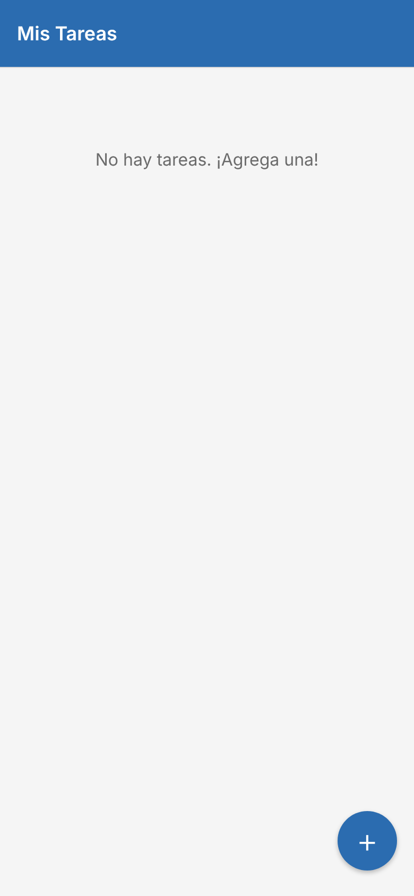 | 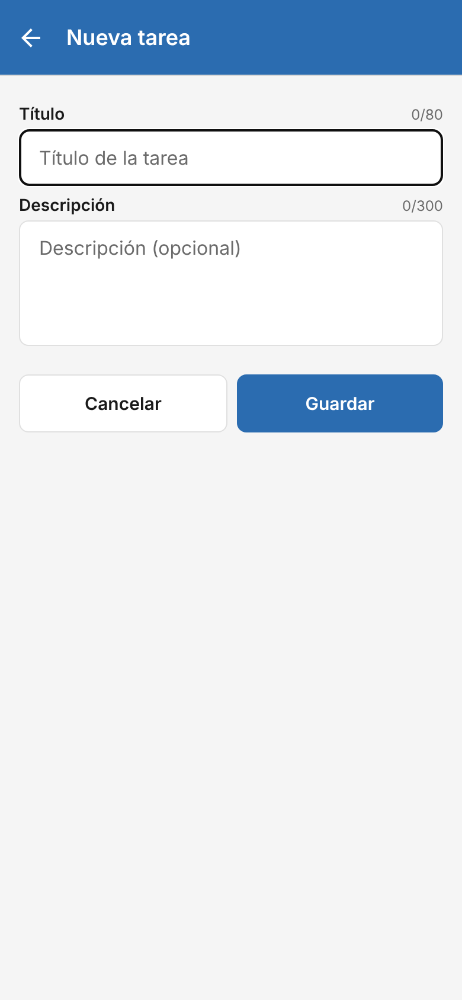 | 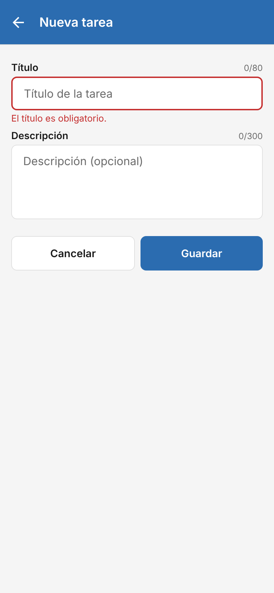 | 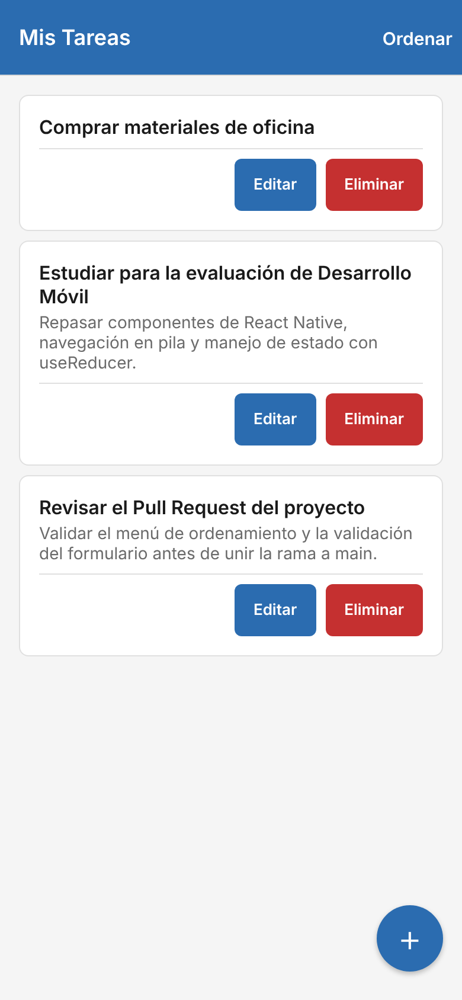 |
| **Menú ordenar** | **Más antiguas primero** | **Editar** | **Confirmar eliminación** |
| 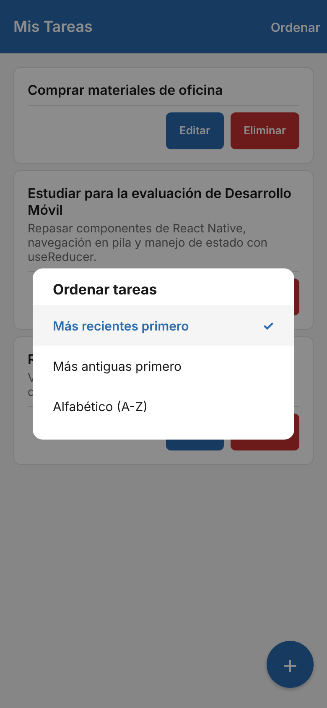 | 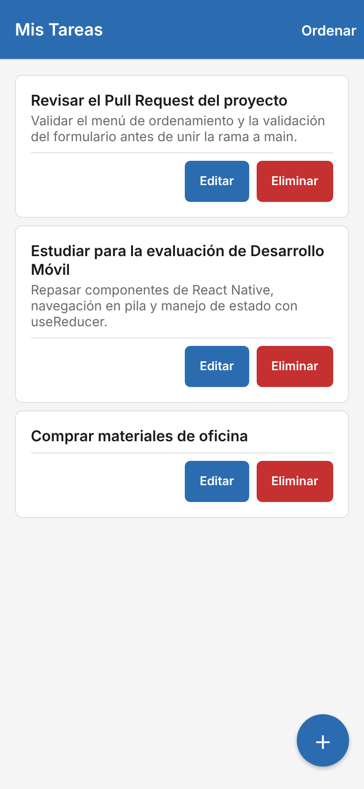 | 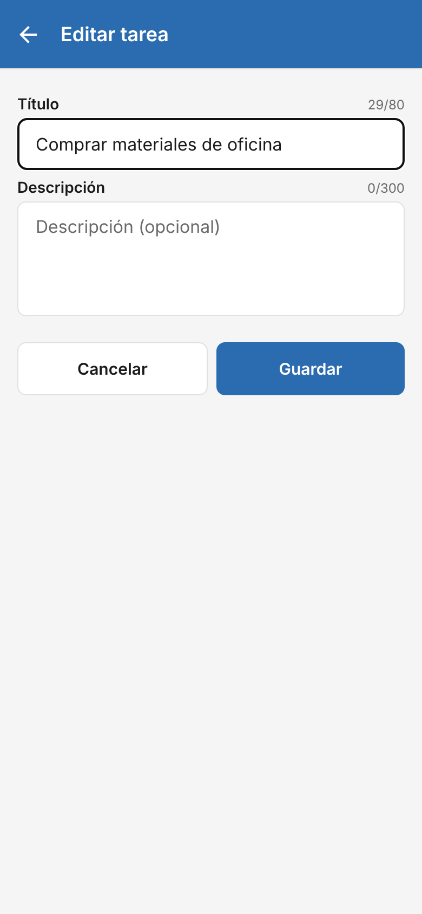 | 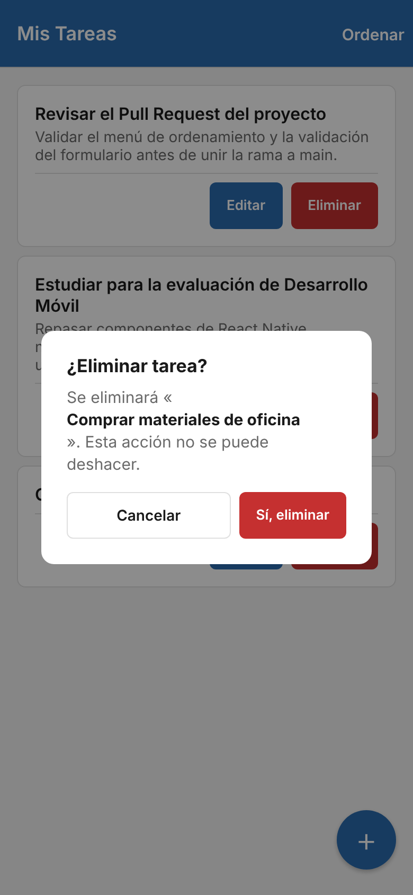 |

## Instalación y ejecución

Requisitos: [Node.js](https://nodejs.org/) LTS (v20 o superior) y la app **Expo Go** en el celular.

```bash
git clone https://github.com/CrisBustosE/EVU1_MERINO_CAMILO_BUSTOS_CRISTOBAL.git
cd EVU1_MERINO_CAMILO_BUSTOS_CRISTOBAL
npm install
npx expo start
```

Escanear el código QR con Expo Go (Android) o con la cámara (iOS), con el celular y el computador en la misma red Wi-Fi. Si no están en la misma red, usar `npx expo start --tunnel`.

## Proceso de desarrollo

1. **Entorno:** instalación de Node.js, Git, VS Code y Expo Go. No requiere una CLI global: Expo se ejecuta con `npx`.
2. **Creación del proyecto:** `npx create-expo-app --template blank-typescript`, y luego se instalaron React Navigation y AsyncStorage con `npx expo install`.
3. **Especificación:** antes de programar definimos los requisitos y criterios de aceptación en [`docs/1_BRIEF.md`](docs/1_BRIEF.md) y las convenciones en [`docs/3_STACK.md`](docs/3_STACK.md).
4. **Desarrollo:** trabajo en ramas y Pull Requests en GitHub, con commits según Conventional Commits.
5. **Verificación:** `npx tsc --noEmit` sin errores, `npm test` (11 pruebas de la Unidad 1 en esta primera entrega; ver el total actual en la sección [Pruebas](#pruebas) de la Unidad 2) y pruebas en un dispositivo con Expo Go.

## Estructura del proyecto

```
App.tsx                  Navegación (stack) y carga inicial
src/
├── components/          TaskItem, SortMenu, PhotoPicker, PhotoThumbnail, LocationField, PermissionNotice, FormActions
├── screens/             TaskListScreen (lista), TaskFormScreen (formulario)
├── reducers/            taskReducer: acciones LOAD, ADD, EDIT, DELETE
├── hooks/               useTasks, useSortedTasks, usePhotoAttachment, useLocationCapture, usePermissionRefresh, useKeyboardHeight
├── services/            photoPicker, photoStorage, location, maps, haptics, permissions (único lugar que importa expo-*)
├── types/               Task, SortOrder, tipos de navegación
├── constants/           Colores, espaciados, límites y textos
└── utils/               migrateTasks (migración de datos de la Unidad 1)
docs/                    1_BRIEF.md, 2_DOMAIN.md, 3_STACK.md, 4_DESIGN.md, 5_MVP.md y capturas
```

## Componentes principales

| Elemento | Dónde se usa en el proyecto |
|---|---|
| Header del `Stack.Navigator` | Cabecera superior configurada en `App.tsx` con React Navigation |
| `FlatList` | Lista principal con renderizado virtualizado en `TaskListScreen` |
| `TaskItem` | Tarjeta de tarea con título, descripción y botones Editar/Eliminar |
| `TextInput` | Campos de entrada para título y descripción en `TaskFormScreen` |
| `TouchableOpacity` | Botones de acción (Guardar, Eliminar, Editar) y botón flotante "+" |
| `Modal` | Diálogo de confirmación en `TaskItem` y menú de selección en `SortMenu` |
| Botón "Ordenar" con `SortMenu` | Botón interactivo en el header de `TaskListScreen` para ordenar tareas |

El estado se maneja con `useReducer` dentro del hook `useTasks`. Las pantallas reciben solo las funciones `saveTask` y `deleteTask`, sin saber cómo se guardan los datos.

## Conceptos fundamentales de React Native y Expo

### Arquitectura y entorno
- **React Native (`0.88.0`):** compila la interfaz a vistas nativas de Android e iOS en lugar de renderizar HTML dentro de un WebView. El código de la aplicación está escrito en TypeScript con tipado estricto.
- **Expo (`~58.0.19`) en Managed Workflow:** administra la compilación nativa y el ciclo de vida del proyecto sin necesidad de mantener carpetas `android/` o `ios/` manuales.
- **Expo Go:** cliente de desarrollo instalado en el dispositivo móvil que ejecuta el bundle JavaScript vía red local o túnel (`npx expo start`), acelerando las pruebas en hardware real.

### Terminología y conceptos clave
- **Componente funcional:** funciones de JavaScript/TypeScript que retornan elementos de interfaz; por ejemplo, `TaskItem` en `src/components/TaskItem.tsx`.
- **JSX:** sintaxis declarativa similar a XML utilizada para estructurar los elementos visuales dentro del código TypeScript (`.tsx`).
- **Props:** parámetros inmutables pasados de un componente padre a un hijo; por ejemplo, `{ task, onEdit, onDelete }` en `TaskItemProps`.
- **State (`useState`):** memoria local y reactiva de un componente; por ejemplo, `const [title, setTitle] = useState(existing?.title ?? '')` en `TaskFormScreen.tsx`.
- **Hooks:**
  - `useReducer`: gestiona el estado mediante acciones tipadas y un reducer puro; usado en `src/hooks/useTasks.ts` junto con `taskReducer`.
  - `useEffect`: manejo de sincronización y efectos secundarios; usado en `useTasks.ts` para cargar y guardar en `AsyncStorage`.
  - `useMemo`: memorización de valores derivados costosos; usado en `src/hooks/useSortedTasks.ts` para ordenar la lista sin recalcular en renders innecesarios.
  - `useCallback`: estabilización de referencias de funciones pasadas como props; usado en `useTasks.ts` para `saveTask` y `deleteTask`.
- **StyleSheet (`StyleSheet.create`):** objeto de estilos reutilizable creado una sola vez fuera del ciclo de render y tipado por TypeScript.
- **FlatList:** lista virtualizada eficiente que monta y desmonta ítems según el scroll; usada en `TaskListScreen.tsx`.
- **Navegación en pila (React Navigation):** pila nativa gestionada por `@react-navigation/native-stack` (`createNativeStackNavigator`) en `App.tsx`, permitiendo transiciones nativas entre `TaskList` y `TaskForm`.

### Componentes clave del proyecto

| Elemento | Para qué se usa | Dónde se utiliza |
|---|---|---|
| `View` | Contenedor estructural básico equivalente a un `div` con Flexbox nativo | `App.tsx`, `TaskListScreen.tsx`, `TaskFormScreen.tsx`, `TaskItem.tsx`, `SortMenu.tsx` |
| `Text` | Renderizado de cadenas de texto y etiquetas accesibles | Todas las pantallas y componentes de `src/` |
| `TextInput` | Campo de entrada editable para título y descripción con límite de caracteres | `src/screens/TaskFormScreen.tsx` |
| `TouchableOpacity` | Elemento interactivo con respuesta táctil y opacidad al pulsar | `TaskListScreen.tsx` (FAB y header), `TaskItem.tsx`, `TaskFormScreen.tsx`, `SortMenu.tsx` |
| `FlatList` | Renderizado virtualizado y optimizado de la colección de tareas | `src/screens/TaskListScreen.tsx` |
| `Modal` | Vista superpuesta sobre la pantalla actual para diálogos flotantes | `src/components/TaskItem.tsx` (confirmar borrado) y `src/components/SortMenu.tsx` (orden) |

## Patrones de diseño aplicados

| Patrón | Dónde se aplica | Qué problema resuelve |
|---|---|---|
| **Reducer** | `src/reducers/taskReducer.ts` | Centraliza las mutaciones de la lista en una función pura y predecible mediante acciones (`LOAD`, `ADD`, `EDIT`, `DELETE`). |
| **Custom Hook** | `src/hooks/useTasks.ts` y `src/hooks/useSortedTasks.ts` | Separa la lógica de negocio, persistencia y ordenamiento de los componentes visuales de interfaz. |
| **Props hacia abajo, eventos hacia arriba** | `App.tsx` → `TaskListScreen.tsx` → `TaskItem.tsx` | Desacopla la vista de la persistencia: las pantallas consumen datos y emiten eventos (`saveTask`, `deleteTask`). |
| **Componentes controlados** | `src/screens/TaskFormScreen.tsx` | El valor de los inputs (`title`, `description`) refleja estrictamente el estado local de React en cada pulsación. |
| **Estado local de UI vs. estado de dominio** | `src/components/TaskItem.tsx` | El estado visual efímero (`expanded`) no contamina el reducer global ni la base de datos de tareas. |
| **Datos derivados con useMemo** | `src/hooks/useSortedTasks.ts` | Evita mutar el arreglo original y reordena la colección solo cuando cambian las tareas o el criterio de orden. |
| **Persistencia segura con flag `isLoaded`** | `src/hooks/useTasks.ts` | Previene que el arreglo vacío inicial sobrescriba el almacenamiento persistente antes de completar la lectura inicial. |
| **Medición con texto gemelo invisible** | `src/components/TaskItem.tsx` | Permite detectar si un texto supera las líneas permitidas en Android e iOS sin depender del reporte truncado de `onTextLayout`. |

### Reducer (`src/reducers/taskReducer.ts`)
Centraliza las transiciones de estado de forma pura y determinista, recibiendo el estado anterior y una acción tipada.

```typescript
export function taskReducer(state: Task[], action: TaskAction): Task[] {
  switch (action.type) {
    case 'LOAD':
      return action.payload;
    case 'ADD':
      return [...state, action.payload];
    case 'EDIT':
      return state.map((t) => (t.id === action.payload.id ? action.payload : t));
    case 'DELETE':
      return state.filter((t) => t.id !== action.payload);
  }
}
```

### Custom Hooks (`src/hooks/useTasks.ts` y `src/hooks/useSortedTasks.ts`)
Encapsulan la interacción con `AsyncStorage`, la suscripción a eventos y las transformaciones de datos fuera del árbol de renderizado.

```typescript
  // Cargar tareas al montar
  useEffect(() => {
    async function loadTasks() {
      try {
        const raw = await AsyncStorage.getItem(STORAGE_KEYS.tasks);
        dispatch({ type: 'LOAD', payload: migrateTasks(raw ? JSON.parse(raw) : []) });
      } catch {
        dispatch({ type: 'LOAD', payload: [] });
      } finally {
        setIsLoaded(true);
      }
    }

    loadTasks();
  }, []);
```

### Props hacia abajo, eventos hacia arriba (`App.tsx` y `src/screens/TaskListScreen.tsx`)
La pantalla raíz `App.tsx` provee las tareas y despachadores hacia las pantallas secundarias mediante props, manteniendo la jerarquía desacoplada.

```typescript
        <Stack.Screen
          name="TaskList"
          options={{ title: STRINGS.appTitle }}
        >
          {(props) => (
            <TaskListScreen {...props} tasks={tasks} onDelete={deleteTask} />
          )}
        </Stack.Screen>
```

### Componentes controlados (`src/screens/TaskFormScreen.tsx`)
El formulario sincroniza bidireccionalmente el valor de los campos de texto con el estado local de React, permitiendo limpiar errores y contar caracteres de forma reactiva.

```typescript
      <TextInput
        style={[styles.input, titleError && styles.inputError]}
        placeholder={STRINGS.titlePlaceholder}
        placeholderTextColor={COLORS.textMuted}
        value={title}
        onChangeText={handleTitleChange}
        maxLength={LIMITS.titleMaxLength}
        autoFocus
        accessibilityLabel={STRINGS.titleLabel}
      />
```

### Estado local de UI vs. estado de dominio (`src/components/TaskItem.tsx`)
El estado de expansión `expanded` vive únicamente en `TaskItem` mediante `useState`, ya que es un detalle visual que no debe persistirse en el almacenamiento ni alterar a las demás tareas.

```typescript
export default function TaskItem({ task, onEdit, onDelete }: TaskItemProps) {
  const [confirmVisible, setConfirmVisible] = useState(false);
  const [expanded, setExpanded] = useState(false);
  const [titleTruncated, setTitleTruncated] = useState(false);
  const [descTruncated, setDescTruncated] = useState(false);
```

### Datos derivados con useMemo (`src/hooks/useSortedTasks.ts`)
El cálculo del ordenamiento crea una copia superficial (`[...tasks]`) dentro de `useMemo`, preservando el arreglo original del reducer y recalculando la vista solo ante cambios en `tasks` u `order`.

```typescript
export function useSortedTasks(tasks: Task[], order: SortOrder): Task[] {
  return useMemo(() => {
    const copy = [...tasks];
    switch (order) {
      case 'newest':
        return copy.sort((a, b) => b.createdAt - a.createdAt);
      case 'oldest':
        return copy.sort((a, b) => a.createdAt - b.createdAt);
      case 'alphabetical':
        return copy.sort((a, b) => a.title.localeCompare(b.title, 'es', { sensitivity: 'base' }));
    }
  }, [tasks, order]);
}
```

*Nota:* Los casos "newest" y "oldest" ordenan por `createdAt`; las tareas de la Unidad 1 (sin `createdAt`) se migran con `Number(id)` en `migrateTasks`.

### Persistencia segura con flag `isLoaded` (`src/hooks/useTasks.ts`)
Un `useEffect` de guardado condicionado estrictamente al flag `isLoaded` evita la pérdida accidental de información al iniciar la aplicación.

```typescript
  // Persistir solo tras la carga inicial para evitar sobrescribir con el estado vacío
  useEffect(() => {
    if (!isLoaded) return;
    AsyncStorage.setItem(STORAGE_KEYS.tasks, JSON.stringify(tasks)).catch(() => null);
  }, [tasks, isLoaded]);
```

### Medición con texto gemelo invisible (`src/components/TaskItem.tsx`)
En nuestras pruebas en Android, observamos que al definir `numberOfLines`, el evento `onTextLayout` no reportaba más líneas que el límite visible configurado, haciendo que la condición de desborde nunca se cumpliera. Para solucionarlo, renderizamos un elemento gemelo oculto sin `numberOfLines` que calcula las líneas reales del texto original, a costo de duplicar la medición del texto en la vista.

```typescript
          {/* Textos gemelos invisibles para medición precisa sin numberOfLines */}
          <Text
            style={[styles.title, styles.measuringText]}
            onTextLayout={handleTitleMeasurement}
            accessibilityElementsHidden
            importantForAccessibility="no-hide-descendants"
          >
            {task.title}
          </Text>
```

## Decisiones de diseño y usabilidad

- **Descripción opcional:** en listas de pendientes muchas tareas son breves y autoexplicativas ("Comprar pan", "Llamar al médico"), por lo que forzar una descripción aumentaría la fricción innecesariamente.
- **Límites de caracteres (80/300) y validación inline:** se incorporaron contadores en tiempo real que informan al usuario antes de alcanzar el tope. Si el título está vacío, se resalta el campo con borde rojo y un mensaje inferior en lugar de desplegar diálogos bloqueantes (`Alert`).
- **Confirmación antes de eliminar:** previene la pérdida accidental de datos mostrando un modal que resalta entre comillas y en negrita el título de la tarea a borrar.
- **Expansión inline selectiva ("Ver más / Ver menos"):** el botón interactivo aparece únicamente cuando el texto supera las 2 líneas en título o 3 en descripción, conservando tarjetas compactas sin sacrificar legibilidad.
- **Contraste accesible (WCAG AA) y áreas táctiles:** colores configurados en `src/constants/index.ts` (`primary: #2B6CB0`, `danger: #C53030`, `text: #1A1A1A`) que garantizan un contraste superior a 4.5:1 frente a superficies blancas y fondos claros. Todos los botones cumplen un área táctil mínima de 44 × 44 dp.
- **Menú de ordenamiento accesible:** permite clasificar las tareas por antigüedad o alfabéticamente desde el header cuando hay 2 o más ítems. El criterio seleccionado vive en memoria de vista y vuelve a "más recientes primero" al reiniciar la app, manteniendo la lista por defecto alineada a la cronología de creación.

## Limitaciones y trabajo futuro

1. **Estado de completitud de tareas:** actualmente las tareas solo pueden crearse, editarse o eliminarse; una mejora natural es añadir una casilla de verificación (*checkbox*) para marcarlas como completadas.
2. **Persistencia del criterio de orden:** el ordenamiento seleccionado en `SortMenu` se mantiene durante la sesión activa en memoria, pero no se guarda en `AsyncStorage`, volviendo a "más recientes" al reabrir la app.
3. **Categorización o etiquetas por tarea:** incorporar etiquetas de colores o categorías (ej. "Trabajo", "Personal", "Urgente") para facilitar la organización de volúmenes mayores de tareas.

## Unidad 2: APIs del dispositivo

En esta unidad la app suma cuatro APIs internas del dispositivo: foto adjunta, ubicación con mapas, háptica y permisos. Todo funciona en Expo Go, sin development build.

### Alcance

El profesor indicó que solo se evalúan las APIs internas del dispositivo (no servicios web) y que el README es el informe de entrega. Por eso la app no tiene backend ni llamadas de red propias.

La pauta pide plugins de Capacitor, que son para apps web dentro de un WebView. Como el proyecto es React Native, usamos los módulos de Expo equivalentes:

| Plugin de Capacitor | Módulo de Expo usado | ¿Lo pide la pauta? | Justificación |
|---|---|---|---|
| `@capacitor/camera` | `expo-image-picker` | Sí | Abre la cámara y la galería con los selectores del sistema; la galería no requiere permiso de lectura. |
| `@capacitor/geolocation` | `expo-location` | Sí | Posición actual con permiso solo en primer plano y `reverseGeocodeAsync` para la dirección legible. |
| `@capacitor/filesystem` | `expo-file-system` | No, agregado nuestro | Copia la foto a la carpeta de documentos de la app para que persista aunque se borre el original. |
| `@capacitor/haptics` | `expo-haptics` | No, agregado nuestro | Vibración de éxito al guardar y de advertencia al eliminar. |

Para abrir la app de mapas y los ajustes del sistema se usa `Linking` de React Native, que no requiere instalación.

### Funcionalidades

#### Foto adjunta

Al crear o editar una tarea, el botón "Tomar foto" abre la cámara y "Elegir de galería" abre el selector del sistema (`expo-image-picker`). La imagen elegida se copia a la carpeta de documentos de la app con la API actual de `expo-file-system` (`File`, `Directory`, `Paths`, no la `legacy`); la tarea guarda solo la **URI de esa copia**, nunca la URI temporal del selector, para que la foto siga disponible aunque el original se borre.

- **Una foto por tarea:** la nueva foto reemplaza a la anterior; el botón "Quitar" la elimina sin reemplazo.
- **Borrado del archivo copiado:** al quitar la foto, reemplazarla por otra o eliminar la tarea, se borra el archivo de la copia anterior. El borrado es tolerante a archivo inexistente. En la práctica (`usePhotoAttachment`), el archivo anterior se borra recién al guardar (`commit`); si se sale del formulario sin guardar, se borran solo las copias nuevas creadas en esa sesión y se conserva el archivo original.
- **Miniatura con placeholder:** la lista y el formulario muestran una miniatura de 56 × 56 dp (`PhotoThumbnail`); si `photoUri` existe pero el archivo ya no está en disco, se muestra un placeholder en vez de un espacio roto.
- **Galería sin permiso de lectura:** `launchImageLibraryAsync` usa el selector del sistema, que no requiere permiso de lectura; solo la cámara pide permiso.

| Formulario con foto | Lista con miniatura | Selector de galería |
|:---:|:---:|:---:|
| 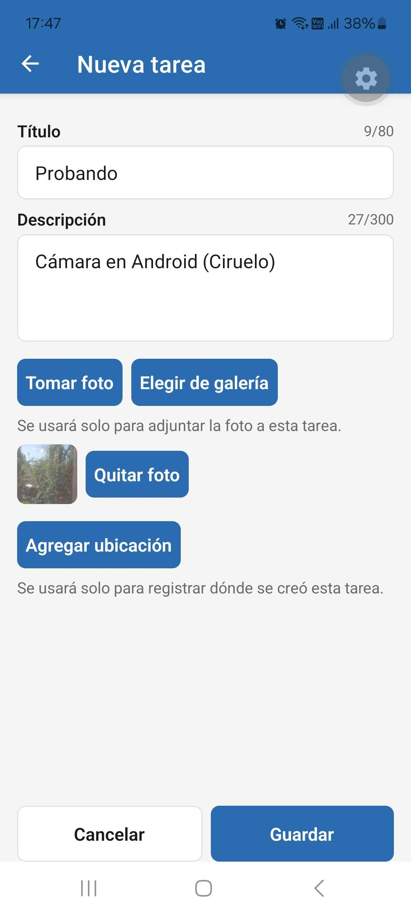 | 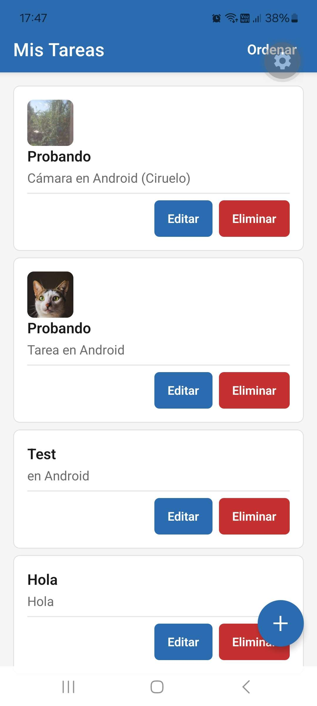 | 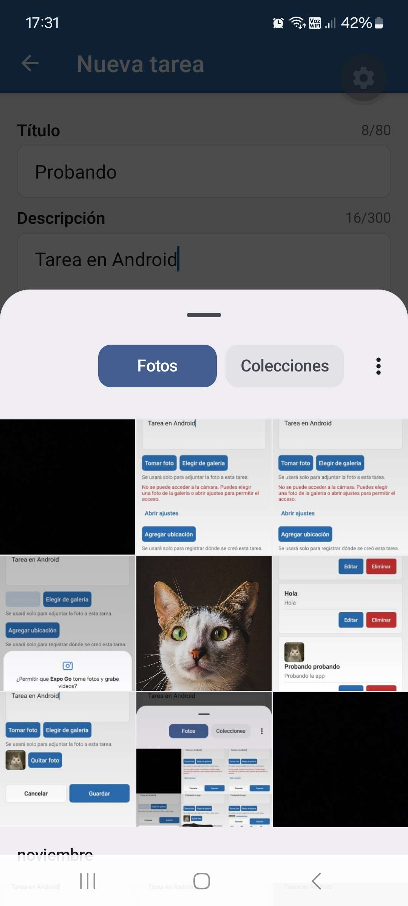 |

#### Ubicación y mapas

Al crear una tarea, el botón "Agregar ubicación" pide la posición actual (`expo-location`). Con ella se guardan `location` (latitud, longitud y precisión en metros) y `address`, la dirección legible que entrega `reverseGeocodeAsync`.

- **A pedido del usuario:** la ubicación se registra solo cuando se pulsa el botón, nunca al abrir la app. Es un dato sensible y la app no tiene ningún caso de uso que la necesite en segundo plano.
- **Tolerante a fallos:** si el GPS no responde en 15 segundos (`LOCATION_TIMEOUT_MS`) se muestra un mensaje y se puede reintentar o guardar sin ubicación. Si falla la geocodificación, por ejemplo sin internet, se conservan solo las coordenadas.
- **Opcional y editable solo al crear:** se puede quitar antes de guardar. Al editar una tarea, la ubicación es de solo lectura.
- **Abrir en mapas:** el botón "Abrir en mapas" aparece en el formulario y en la lista. Entrega las coordenadas a la app de mapas del dispositivo con `maps:` en iOS y `geo:` en Android.

| Formulario (solo lectura al editar) | Lista de tareas | Apple Maps |
|:---:|:---:|:---:|
| 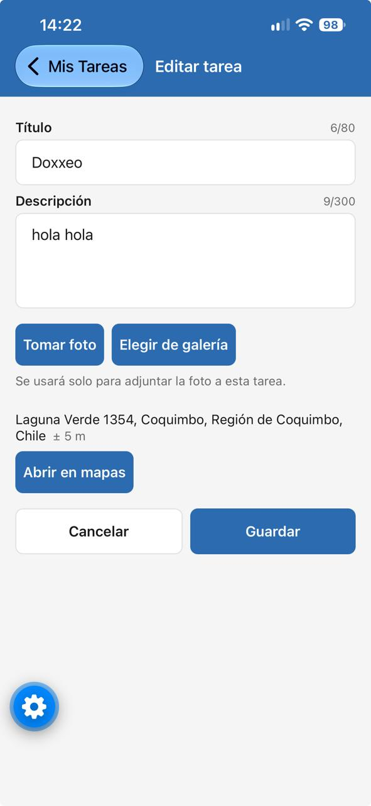 | 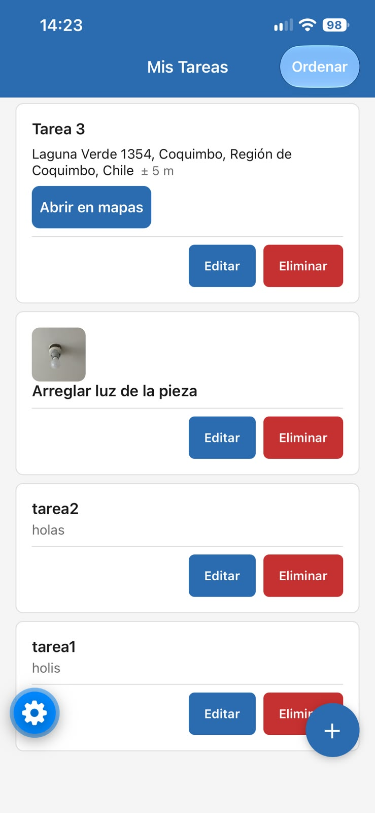 | 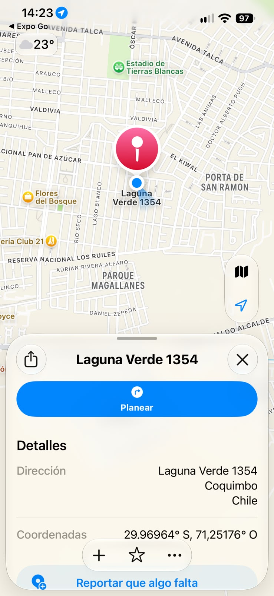 |

| Ubicación agregada (Android, simulada) | Abrir en mapas (Android) |
|:---:|:---:|
| 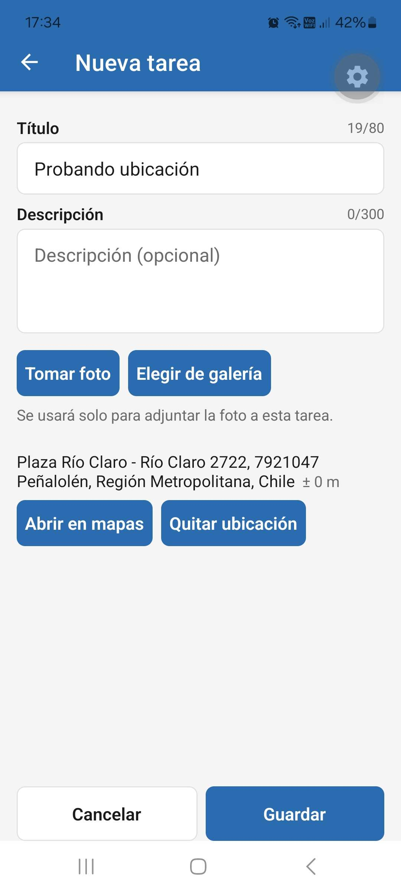 | 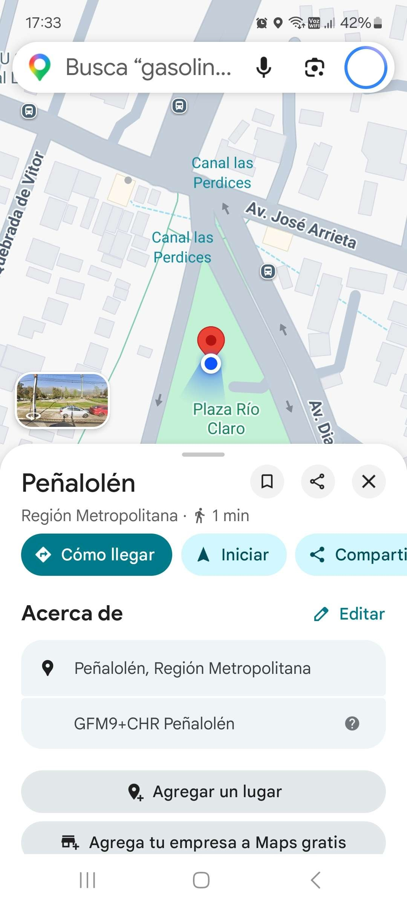 |

En modo avión el GPS sigue funcionando, pero la geocodificación no: la tarea se guarda con las coordenadas (`-29.96961, -71.25180 ± 4 m`) en lugar de la dirección.

#### Háptica

`expo-haptics` da retroalimentación al usuario en dos acciones (`src/services/haptics.ts`):

- **Guardar una tarea:** vibración de éxito (`Success`), solo si el formulario es válido.
- **Confirmar la eliminación:** vibración de advertencia (`Warning`), solo si se pulsa "Eliminar" en el modal; cancelar no vibra.

En dispositivos sin soporte háptico el error se ignora en silencio: no pasa nada ni se muestra un mensaje.

#### Arreglos del formulario

Al agregar los bloques de foto y ubicación, el formulario de `src/screens/TaskFormScreen.tsx` creció y el teclado empezó a tapar los controles ("Cancelar"/"Guardar"). Se corrigió así:

- **Android:** `FormActions` (botones "Cancelar"/"Guardar" extraídos a componente) se renderiza como pie fijo fuera del `ScrollView`, con `paddingBottom = keyboardHeight + insets.bottom` si el teclado está visible, o `insets.bottom` si está oculto. `keyboardHeight` lo calcula el hook `useKeyboardHeight` a partir del evento `keyboardDidShow`; en edge-to-edge no incluye la barra de navegación del sistema (el teclado la cubre), por eso se suma `insets.bottom` también con el teclado visible.
- **iOS:** no cambia nada; `FormActions` sigue dentro del `ScrollView`, que ya usa `automaticallyAdjustKeyboardInsets` para desplazarse sobre el teclado.
- La tecla "siguiente" del título pasa el foco a la descripción.
- Foto, ubicación y botones comparten una separación vertical uniforme con `gap` en un solo contenedor, en vez de márgenes sueltos en cada hijo.

| Botones visibles sobre el teclado (Android) |
|:---:|
| 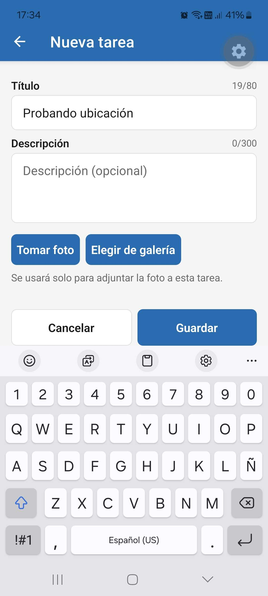 |

### Permisos y privacidad

- **Bajo demanda:** ningún permiso se pide al iniciar la app. Se piden al pulsar "Agregar ubicación" (o al usar la cámara) y bajo cada botón hay un texto que explica para qué se usará. Los textos que muestra el sistema se declaran en español en `app.json`; el de ubicación es "Se usará tu ubicación solo para registrar dónde creaste esta tarea."
- **Solo en primer plano:** la ubicación usa `requestForegroundPermissionsAsync`; no se usa ubicación en segundo plano.
- **Estados de permiso:** `PermissionStatus` distingue sin decidir, concedido, denegado y bloqueado (`canAskAgain: false`). La interfaz trata denegado y bloqueado igual: al pulsar de nuevo se vuelve a llamar a la API de permisos, y si el sistema no puede mostrar el diálogo, responde al instante y se muestra el aviso. Así el permiso funciona si el usuario lo cambia en los ajustes.
- **Aviso con "Abrir ajustes":** `PermissionNotice` muestra un mensaje inline, sin diálogos bloqueantes, y un botón que llama a `Linking.openSettings()`. La app sigue usable y la tarea se puede guardar sin ubicación.
- **`usePermissionRefresh`** (`src/hooks/usePermissionRefresh.ts`): al volver a primer plano con el aviso visible, relee el permiso del sistema. Si el usuario lo activó en los ajustes, el aviso desaparece solo, sin reiniciar la app.
- **Datos solo en el dispositivo:** `location`, `address` y `photoUri` se guardan en `AsyncStorage` y nunca se envían a un servidor, porque la app no tiene backend. La única salida es `reverseGeocodeAsync`, que usa el servicio de geocodificación del sistema operativo.

**Normativa chilena.** Hoy rige la [Ley 19.628, sobre protección de la vida privada](https://www.bcn.cl/leychile/navegar?idNorma=141599). Su reemplazo, la [Ley 21.719, que regula la protección y el tratamiento de los datos personales](https://www.bcn.cl/leychile/navegar?idNorma=1209272) (Biblioteca del Congreso Nacional), tiene como fecha de entrada en vigencia prevista el 1 de diciembre de 2026, aunque a la fecha de este informe existe un proyecto de ley en trámite para postergar esa entrada en vigencia, por lo que esa fecha no debe tomarse como definitiva. En cualquier caso, la app sigue los principios de ambas normas:

- **Finalidad:** la ubicación se usa solo para registrar dónde se creó la tarea, y así se informa al usuario antes de pedirla.
- **Minimización de datos:** solo se guarda lo necesario (coordenadas, precisión y dirección), nada en segundo plano y nada que el usuario no haya pedido.
- **Consentimiento:** el dato se obtiene únicamente cuando el usuario pulsa el botón y acepta el permiso del sistema; puede quitarlo antes de guardar.

#### Cámara y permisos

El permiso de cámara se pide bajo demanda, al pulsar "Tomar foto" (`requestCameraPermissionsAsync`), nunca al iniciar la app. Si el usuario lo rechaza, se muestra un aviso inline (`PermissionNotice`) con el botón "Abrir ajustes" (`Linking.openSettings()`); la galería (`launchImageLibraryAsync`) usa el selector del sistema y **no requiere permiso de lectura**, por lo que nunca muestra este aviso.

- **Denegado o bloqueado se tratan igual:** al pulsar "Tomar foto" de nuevo, siempre se vuelve a llamar a la API de permisos (`requestCameraPermissionsAsync`); si el sistema no puede mostrar el diálogo (`canAskAgain: false`), devuelve el resultado al instante y se muestra el mismo aviso. Así el permiso funciona si el usuario lo cambia en los ajustes (p. ej. a "Preguntar siempre").
- **El aviso se actualiza solo:** `usePhotoAttachment` se suscribe a `AppState` y relee el permiso al volver a primer plano mientras el aviso está visible, sin reiniciar la app.
- **Copia y borrado:** ver "Foto adjunta" más arriba; el permiso solo protege la apertura de la cámara, no la copia del archivo.

| Diálogo de permiso | Permiso rechazado | Cámara en uso |
|:---:|:---:|:---:|
| 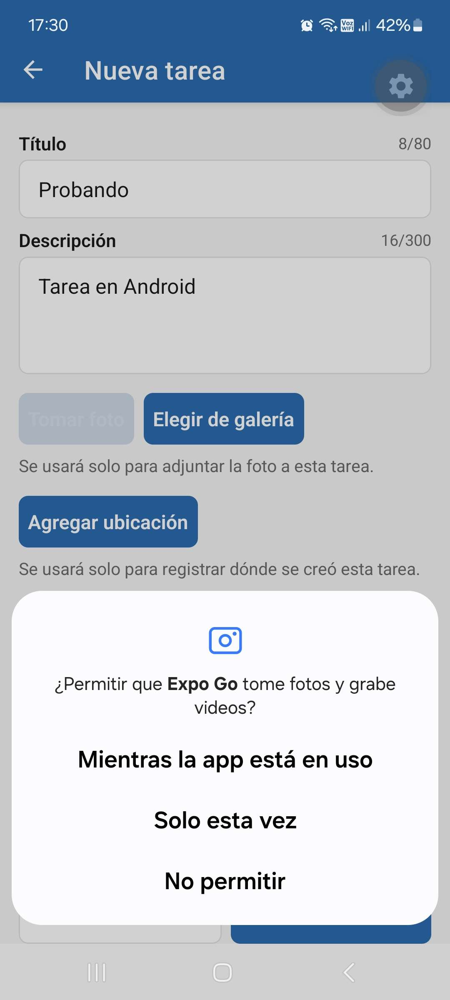 | 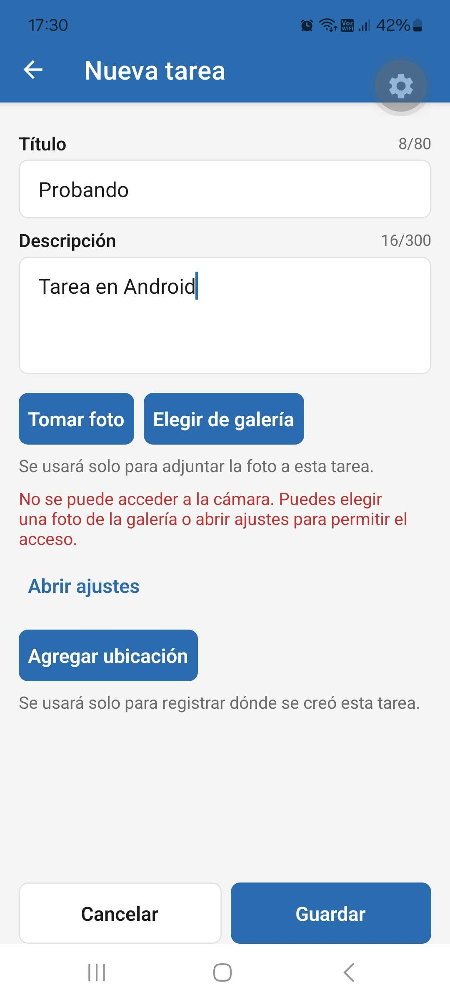 | 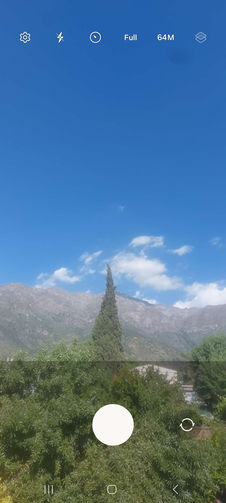 |

### Arquitectura

El acceso a los módulos nativos está aislado en una capa de servicios; las pantallas y los componentes nunca importan `expo-*`.

```
src/
├── services/    location.ts, maps.ts, haptics.ts, permissions.ts, photoPicker.ts, photoStorage.ts: único lugar que importa expo-location, expo-haptics, expo-image-picker, expo-file-system y Linking
├── hooks/       useLocationCapture.ts, usePermissionRefresh.ts, usePhotoAttachment.ts, useKeyboardHeight.ts: estado y flujo de la función, sobre los servicios
├── components/  LocationField.tsx, PermissionNotice.tsx, PhotoPicker.tsx, PhotoThumbnail.tsx, FormActions.tsx: UI pura
└── screens/     TaskFormScreen.tsx: compone hooks y componentes
```

- **Capa de servicios:** `captureLocation()` pide el permiso, obtiene la posición con timeout (`Promise.race`) y resuelve la dirección. `openInMaps()` y las funciones de `haptics.ts` encapsulan `Linking` y `expo-haptics`.
- **Hooks:** `useLocationCapture` guarda `location`, `address`, el estado del permiso, `busy` y el error. `TaskFormScreen` solo consume ese estado.
- **Resultados tipados:** los servicios no lanzan excepciones hacia la interfaz; devuelven una unión discriminada que el hook traduce a estado y a mensajes de `STRINGS`:

```typescript
export type LocationCaptureResult =
  | { status: 'ok'; location: TaskLocation; address?: string }
  | { status: 'denied' | 'blocked' }
  | { status: 'timeout' }
  | { status: 'error' };
```

- **Dependency Inversion:** las pantallas y los componentes dependen de hooks y servicios propios (`useLocationCapture`, `openInMaps`, `hapticSuccess`), no de `expo-*`. Por eso en las pruebas se simulan los módulos nativos o los servicios sin tocar la interfaz, y cambiar de librería solo afectaría a `src/services/`.

### Pruebas

`npm test` ejecuta **131 pruebas en 20 suites** con `jest-expo` y `@testing-library/react-native`. Los módulos nativos (`expo-image-picker`, `expo-file-system`, `expo-location`, `expo-haptics`, `Linking`, `AsyncStorage`) se simulan con `jest.mock`, así que ninguna prueba usa hardware ni red. De ellas, 13 son de la Unidad 1 (reducer, migración y persistencia), 54 cubren foto y permisos, 4 el pie fijo sobre el teclado, y 60 ubicación y háptica:

| Archivo | Pruebas | Casos |
|---|:---:|---|
| `src/reducers/__tests__/taskReducer.test.ts` | 6 | Acciones `LOAD`, `ADD`, `EDIT`, `DELETE` del reducer (Unidad 1) |
| `src/utils/__tests__/migrateTasks.test.ts` | 5 | Migración de tareas sin `createdAt`, IDs no numéricos, descarte de entradas inválidas (Unidad 1) |
| `src/hooks/__tests__/useTasks.test.ts` | 2 | Carga desde `AsyncStorage` y persistencia condicionada al flag `isLoaded` (Unidad 1) |
| `src/services/__tests__/permissions.test.ts` | 8 | Estado sin decidir, concedido, denegado y bloqueado traducido desde cada API de permiso |
| `src/services/__tests__/photoPicker.test.ts` | 10 | Cámara: permiso concedido, denegado y bloqueado (con reintento del request), cancelación, error; galería: selección y cancelación sin pedir permiso |
| `src/services/__tests__/photoStorage.test.ts` | 6 | Copia a la carpeta de documentos con nombre único, borrado tolerante a archivo inexistente |
| `src/components/__tests__/PhotoPicker.test.tsx` | 9 | Tomar foto, elegir de galería, miniatura, quitar foto, aviso de permiso rechazado |
| `src/components/__tests__/PhotoThumbnail.test.tsx` | 4 | Miniatura con imagen y placeholder si el archivo ya no existe en disco |
| `src/components/__tests__/PermissionNotice.test.tsx` | 5 | Mensaje inline y botón "Abrir ajustes" según el estado de permiso |
| `src/hooks/__tests__/usePhotoAttachment.test.ts` | 12 | Tomar foto, elegir de galería, quitar, `commit` borra el archivo anterior, `discard` borra las copias nuevas de la sesión, relectura del permiso al volver a primer plano |
| `src/hooks/__tests__/useKeyboardHeight.test.ts` | 3 | Altura del teclado al mostrarse y ocultarse, limpieza de la suscripción al desmontar |
| `src/components/__tests__/FormActions.test.tsx` | 1 | Renderiza "Cancelar"/"Guardar" y dispara sus callbacks |
| `src/services/__tests__/location.test.ts` | 11 | Permiso concedido, denegado y bloqueado (con reintento del request), timeout del GPS, error del GPS, `accuracy` nulo, dirección compuesta desde sus partes, fallo y timeout de `reverseGeocodeAsync` |
| `src/services/__tests__/maps.test.ts` | 3 | URL `geo:` en Android, `maps:` en iOS, sin app de mapas |
| `src/services/__tests__/haptics.test.ts` | 3 | Éxito, advertencia y dispositivo sin soporte háptico |
| `src/hooks/__tests__/useLocationCapture.test.ts` | 10 | Captura exitosa, `busy`, permiso denegado y bloqueado, timeout y reintento, error del GPS, geocodificación fallida, quitar, ubicación inicial al editar |
| `src/hooks/__tests__/usePermissionRefresh.test.ts` | 6 | Relee al volver a primer plano solo con el aviso visible, usa el estado más reciente, elimina la suscripción al desmontar |
| `src/components/__tests__/LocationField.test.tsx` | 13 | Agregar, `busy`, dirección o coordenadas, precisión, abrir en mapas, quitar, aviso de permiso, errores de timeout y GPS, modo solo lectura |
| `src/components/__tests__/TaskItem.test.tsx` | 5 | Háptica de advertencia al confirmar (y no al cancelar), ubicación en la lista con y sin dirección |
| `src/screens/__tests__/TaskFormScreen.test.tsx` | 9 | Háptica de éxito solo con título válido, guardar con y sin ubicación, permiso rechazado no impide guardar, quitar ubicación, solo lectura al editar, foco "siguiente" |

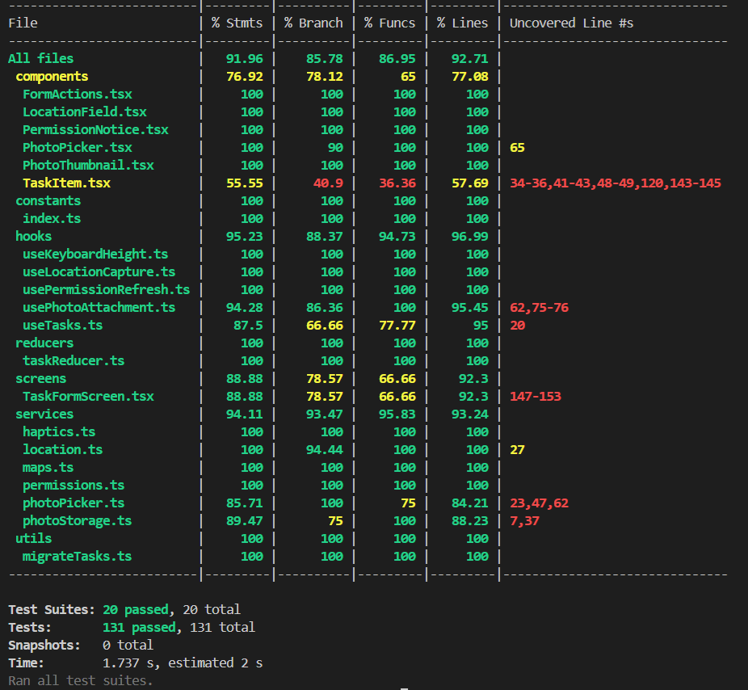

Cobertura global: 91,96 % sentencias, 85,78 % ramas, 86,95 % funciones y 92,71 % líneas. El archivo menos cubierto es `TaskItem.tsx` (55,55 % sentencias): `TaskItem.test.tsx` sí prueba la háptica de advertencia al confirmar la eliminación y la ubicación en la lista (con y sin dirección), pero no ejercita directamente `handleTitleMeasurement`/`handleDescMeasurement` (líneas 34-36 y 41-43, el cálculo de líneas truncadas vía `onTextLayout`), `toggleExpand` (líneas 48-49, el toggle "Ver más"/"Ver menos"), el `onPress` del botón "Editar" (línea 120) ni el cierre del modal de confirmación desde el fondo u `onRequestClose` (líneas 143 y 145).

**Pruebas manuales en iPhone 14 con Expo Go:**

| Escenario | Qué se verificó | Resultado |
|---|---|:---:|
| Agregar ubicación | Al pulsar "Agregar ubicación" aparece el diálogo del sistema; al aceptar se muestran la dirección y la precisión, y quedan guardadas en la tarea | Aprobada |
| Abrir en Apple Maps | "Abrir en mapas" desde la lista y el formulario abre Apple Maps con el punto de la tarea | Aprobada |
| Vibración al guardar y eliminar | Vibra al guardar una tarea válida y al confirmar la eliminación; no vibra al cancelar | Aprobada |
| Edición de solo lectura | Al editar una tarea con ubicación se ve la dirección y "Abrir en mapas", sin "Agregar" ni "Quitar" | Aprobada |
| Permiso rechazado | Aparece el mensaje inline con "Abrir ajustes"; la app no se bloquea y se puede guardar sin ubicación | Aprobada |
| Permiso activado desde ajustes | Tras activarlo en los ajustes y volver a la app, el aviso desaparece y la ubicación se puede agregar | Aprobada |
| Modo avión | Se obtiene la posición, pero sin dirección: se guardan y muestran solo las coordenadas | Aprobada |
| Teclado del formulario | El teclado no tapa los campos ni los botones, el formulario se desplaza y "siguiente" pasa a la descripción | Aprobada |

**Pruebas manuales en Android (Samsung, Expo Go):**

| Escenario | Qué se verificó | Captura | Resultado |
|---|---|:---:|:---:|
| Diálogo de permiso de cámara | Al pulsar "Tomar foto" por primera vez aparece el diálogo nativo del sistema | `u2-android-camara-dialogo.jpg` | Aprobada |
| Permiso de cámara rechazado | Aparece el aviso inline con "Abrir ajustes"; la app no se bloquea y se puede guardar sin foto | `u2-android-camara-rechazada.jpg` | Aprobada |
| Cámara en uso | Al conceder el permiso se abre la cámara del dispositivo | `u2-android-camara-uso.jpg` | Aprobada |
| Selector de galería | "Elegir de galería" abre el selector del sistema sin pedir permiso | `u2-android-galeria.jpg` | Aprobada |
| Foto en el formulario | La foto tomada con la cámara se ve en el formulario antes de guardar | `u2-android-foto-formulario.jpg` | Aprobada |
| Foto en la lista | La tarea guardada muestra la miniatura en la lista | `u2-android-foto-lista.jpg` | Aprobada |
| Ubicación agregada | Al pulsar "Agregar ubicación" se guarda y muestra la posición | `u2-android-ubicacion-formulario.jpg` | Aprobada |
| Abrir en mapas | "Abrir en mapas" abre la app de mapas del dispositivo con el punto de la tarea | `u2-android-abrir-mapas.jpg` | Aprobada |
| Botones sobre el teclado | "Cancelar"/"Guardar" quedan visibles en un pie fijo con el teclado abierto | `u2-android-teclado.jpg` | Aprobada |
| Foto persiste tras reabrir Expo Go | Al cerrar Expo Go por completo y volver a abrir la app, la miniatura sigue visible | Sin Captura | Aprobada |
| Permiso de cámara activado desde ajustes | Tras activarlo en los ajustes del sistema y volver a la app, el aviso desaparece solo, sin reiniciar la app | Sin Captura | Aprobada |

La ubicación de las capturas fue **simulada** con coordenadas de una plaza pública (por eso la precisión se ve como "± 0 m"); no corresponde a la ubicación real del dispositivo de prueba. Además, la cámara del equipo Android usado para las pruebas tiene una falla de enfoque conocida, por lo que las fotos de las capturas salen desenfocadas; esto es una limitación del hardware de prueba, no del código. La prueba en iOS (tabla de arriba) la hizo Camilo en un iPhone 14; Cristóbal no alcanzó a probar la cámara en un dispositivo iOS.

### Proceso

Trabajo en ramas y Pull Requests en GitHub, con commits según Conventional Commits. El responsable es quien escribió los commits del PR.

| PR | Rama | Responsable | Contenido |
|:---:|---|---|---|
| #3 | `chore/evu2-setup` | Camilo | Alcance de la Unidad 2 en el brief y el stack, modelo `Task` con `createdAt`, `photoUri`, `location` y `address`, y configuración de Jest |
| #4 | `docs/evu2-5-docs` | Cristóbal | Documentación reorganizada en 5 archivos numerados (`docs/1_BRIEF.md` a `docs/5_MVP.md`) |
| #5 | `feat/permissions-base` | Cristóbal | Base compartida de permisos: tipo `PermissionStatus`, servicio `permissions.ts` y componente `PermissionNotice` |
| #6 | `feat/photo-attachment` | Cristóbal | Foto adjunta con cámara y galería: `expo-image-picker`, `expo-file-system`, `PhotoPicker` y `usePhotoAttachment` |
| #7 | `feat/location` | Camilo | Ubicación, mapas y háptica, `usePermissionRefresh` |
| #9 | `fix/android-keyboard` | Cristóbal | Pie fijo (`FormActions` + `useKeyboardHeight`) para que "Cancelar"/"Guardar" queden sobre el teclado en Android |
| #8 | `docs/evu2-readme` | Camilo y Cristóbal | README de la Unidad 2: foto, cámara y permisos, capturas en Android, cobertura de pruebas y este PR |

### Pendientes conocidos

- `usePhotoAttachment` tiene su propio `AppState` para releer el permiso de cámara; podría migrar a `usePermissionRefresh` (el hook reutilizable que ya usa `useLocationCapture`), eliminando la duplicación.
- Cobertura de `TaskItem.tsx` (55,55 % sentencias): faltan pruebas directas sobre `handleTitleMeasurement`/`handleDescMeasurement` (truncado vía `onTextLayout`), el toggle "Ver más"/"Ver menos" (`toggleExpand`), el botón "Editar" y el cierre del modal de confirmación desde el fondo o con `onRequestClose`.

## Uso de agentes de IA

Usamos agentes de IA como herramienta de apoyo durante el desarrollo, siguiendo una metodología estructurada: antes de escribir cualquier línea de código, establecimos el flujo de control en [`AGENTS.md`](AGENTS.md), obligando a que cualquier intervención leyera y respetara estrictamente los requisitos de [`docs/1_BRIEF.md`](docs/1_BRIEF.md) y las convenciones arquitectónicas de [`docs/3_STACK.md`](docs/3_STACK.md).

La revisión humana y las pruebas en un dispositivo real fueron parte de cada etapa. Por ejemplo, al probar con Expo Go en un teléfono Android detectamos que el botón "Ver más" no aparecía en tareas largas. Nuestra hipótesis fue que, con `numberOfLines`, el evento `onTextLayout` no informaba las líneas del texto completo, así que pedimos al agente medir con un texto gemelo invisible sin `numberOfLines`. Después del cambio, comprobamos en el teléfono que el botón aparecía solo en los textos largos.

También medimos el contraste de los colores: el blanco sobre el azul y el rojo originales daba 3,29:1 y 3,73:1, por debajo del mínimo de 4,5:1 definido en `docs/4_DESIGN.md`. Se oscurecieron a `#2B6CB0` y `#C53030` (5,42:1 y 5,47:1). Cada cambio se verificó con `npx tsc --noEmit` y revisado a través de Pull Requests en GitHub antes de integrarse a la rama principal.

## Coevaluación del equipo

El documento de autoevaluación y coevaluación del trabajo en equipo se encuentra disponible en el repositorio en la ruta [`docs/Coevaluación_EVA1.pdf`](docs/Coevaluaci%C3%B3n_EVA1.pdf).
